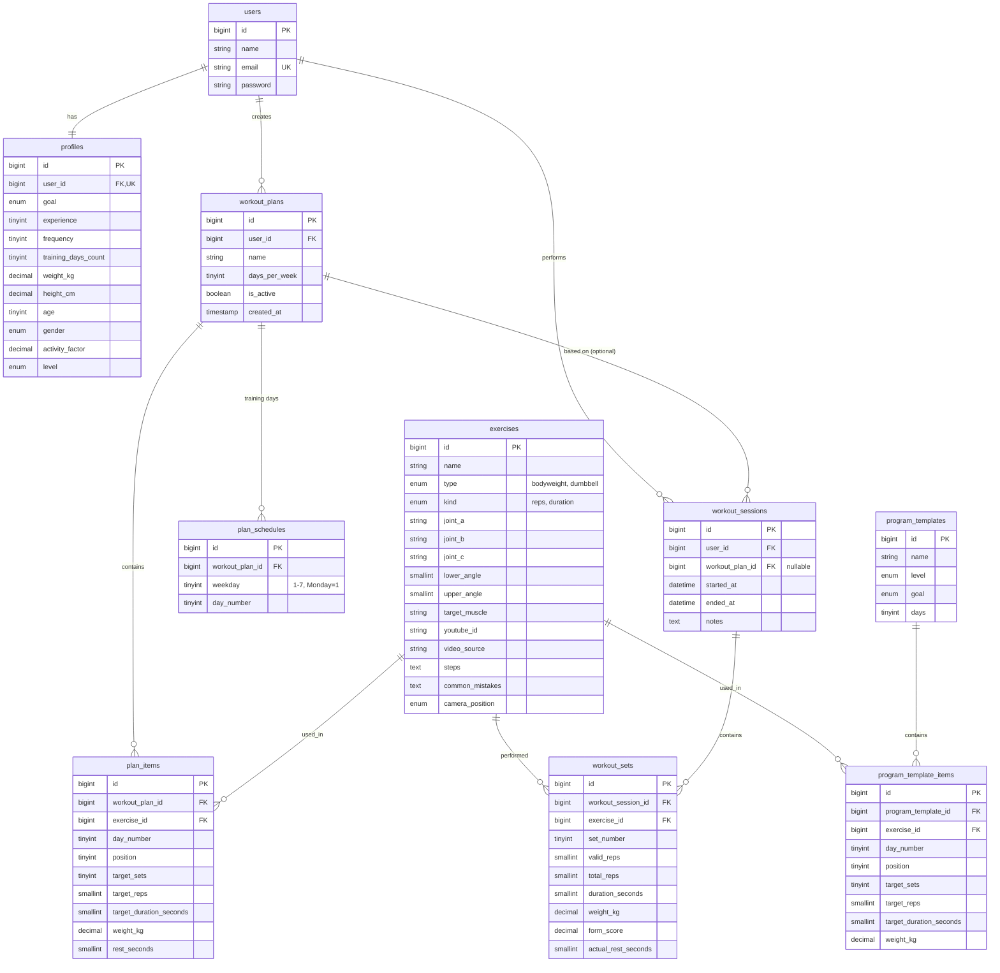

# LiftLog: Konteks Proyek

Tugas UAS Pemrograman Aplikasi Bergerak. Individu, 6 minggu (mulai akhir Oktober 2026).
Aplikasi Android (Flutter) + REST API (Laravel) + MySQL.
Laporan: draft artikel ilmiah mengikuti template JSI, 8-12 halaman.

Dokumen ini dibaca oleh AI lain (Claude, Kimi, GPT, dll.). Ikuti isinya. Jangan menambah fitur di luar scope.

## 1. Ringkasan

LiftLog adalah pencatat latihan yang menghitung repetisi otomatis lewat kamera (deteksi pose on-device), memberi skor form, saran progresi, rencana latihan terjadwal per hari, dan kalkulator kebutuhan tubuh.

Pembeda utama dari aplikasi sejenis: penghitung repetisi berbasis kamera, skor form, penjadwalan per hari dengan kalender, dan penentuan level lewat onboarding.

## 2. Scope (jangan keluar dari ini)

- Hanya latihan **tanpa alat (bodyweight)** dan **dumbbell**. Tidak ada barbel batang, mesin, atau kabel. Kata "barbel" yang dipakai pemilik proyek berarti dumbbell.
- Hanya **8 gerakan** yang bisa dideteksi kamera. Tidak ada gerakan yang dicatat manual.
- **Tidak ada** pelacak makanan atau kalori harian. Hanya kalkulator kebutuhan (BMR, TDEE, protein). Alasan: topik teman sekelas (DeficCal) berfokus ke kalori dan tidak boleh sama.
- Platform **Android saja**. `google_mlkit_pose_detection` tidak jalan di Web/Chrome atau desktop.
- Contoh gerakan memakai **YouTube embed** (`youtube_id`). Tidak mengunduh video. Sumber video dicantumkan.
- Bukan aplikasi medis. Tidak ada klaim koreksi postur atau saran kesehatan. Ada disclaimer di layar awal.
- Topik tidak boleh sama dengan topik teman sekelas (Nugas, KosSync, Habisin, Catatan Keuangan, JejakMagang, AfterBuy, BorrowIt, Moco, DevFolio, Jepret Kampus, dll.).

### Katalog gerakan (master, hanya diisi seeder, tidak bisa diedit user)

| # | Nama | type | kind | Sinyal kamera | camera_position |
|---|------|------|------|---------------|-----------------|
| 1 | Squat | bodyweight | reps | Sudut lutut | side |
| 2 | Push-up | bodyweight | reps | Sudut siku | side |
| 3 | Crunch | bodyweight | reps | Perubahan sudut bahu-pinggul-lutut | side |
| 4 | Forearm Plank | bodyweight | duration | Garis bahu-pinggul-pergelangan kaki | side |
| 5 | Dumbbell Squat | dumbbell | reps | Sudut lutut | side |
| 6 | Zottman Curl | dumbbell | reps | Sudut siku | front |
| 7 | Dumbbell Lateral Raise | dumbbell | reps | Sudut bahu | front |
| 8 | Neutral Grip Front Raise | dumbbell | reps | Sudut bahu | side |

## 3. Stack dan konvensi

- Backend: Laravel (Sanctum untuk token), MySQL, database `liftlog`. Zona waktu `Asia/Jakarta`.
- Frontend: Flutter. Paket utama: `dio`, `provider`, `flutter_secure_storage`, `camera`, `google_mlkit_pose_detection`, `permission_handler`, `youtube_player_iframe`, `url_launcher`, `table_calendar`, `fl_chart`, `flutter_local_notifications`, `intl`. Font dibundel sebagai aset di `assets/fonts/` (Oswald untuk judul, Inter untuk teks isi), tanpa paket `google_fonts` supaya jalan offline.
- **Nama tabel, model, kolom, dan endpoint memakai BAHASA INGGRIS.** Antarmuka (teks di layar) memakai bahasa Indonesia. Istilah latihan seperti rep dan set boleh tetap.
- Model Laravel memakai `protected $guarded = [];`. Relasi yang namanya berbeda dari model memakai argumen foreign key (contoh: `belongsTo(WorkoutPlan::class, 'workout_plan_id')`).
- Kode migration hanya di `database/migrations/`. Model hanya berisi `$guarded`, `$casts`, dan relasi.
- Respons API berupa JSON. Semua endpoint selain register dan login memakai `auth:sanctum`.
- Data user hanya bisa diakses pemiliknya (filter `user_id` di setiap query).
- Tidak ada `get_it`, `go_router`, atau lapisan domain (entity, usecase). Struktur sengaja ringan.

## 4. Skema database



Constraint dan index tambahan:

- Unique `plan_schedules (workout_plan_id, weekday)`.
- Index `workout_sets (exercise_id, workout_session_id)` untuk progresi per gerakan.
- Index `workout_sessions (user_id, started_at)` untuk riwayat dan kalender.

Enum nilai:

- `goal`: `muscle`, `stamina`, `general`
- `level`: `beginner`, `intermediate`, `advanced`
- `gender`: `male`, `female`
- `type`: `bodyweight`, `dumbbell`; `kind`: `reps`, `duration`; `camera_position`: `side`, `front`

## 5. Aturan bisnis

### Penghitung repetisi (mesin berbasis konfigurasi)

Tiap gerakan punya tiga titik sendi (`joint_a`, `joint_b`, `joint_c`), ambang `lower_angle` dan `upper_angle`, dan jenis (`reps` atau `duration`). Menambah gerakan = menambah satu baris di tabel `exercises`, bukan kode baru.

Satu rep valid = siklus atas, bawah, atas. Bila fase bawah tidak tercapai, rep ditandai "kurang" (masuk `total_reps` tapi bukan `valid_reps`).

`form_score = valid_reps / total_reps` (0 sampai 1). Valid bila >= 0.8, Perhatian bila < 0.8.

Ambang awal (dikalibrasi saat uji):

| Gerakan | Fase bawah | Fase atas |
|---|---|---|
| Squat / Dumbbell Squat | Lutut < 100 derajat | Lutut > 160 derajat |
| Push-up | Siku < 90 | Siku > 160 |
| Crunch | Sudut mengecil >= 20-25 derajat dari baseline berbaring (kalibrasi di awal set) | Kembali ke baseline |
| Zottman Curl | Siku > 150 | Siku < 50 |
| Lateral Raise | Lengan-badan < 30 | Lengan-badan > 80 |
| Front Raise | Lengan-badan < 30 | Lengan-badan > 70 |
| Forearm Plank | Timer berjalan hanya saat sudut tubuh 160-180 derajat | |

Arti `lower_angle` dan `upper_angle` di tabel `exercises`: `lower_angle` adalah batas zona sudut kecil (sudut <= nilai itu), `upper_angle` batas zona sudut besar (sudut >= nilai itu). Satu rep valid bila **kedua zona dikunjungi dalam satu siklus** lalu kembali ke zona awal. Gerak yang keluar dari zona awal tapi kembali tanpa mencapai zona lawan dihitung "kurang". Pengecualian:

- **Crunch** memakai selisih dari baseline berbaring: `lower_angle` = pengurangan sudut minimal agar rep valid, `upper_angle` = toleransi untuk dianggap kembali ke baseline.
- **Forearm Plank** memakai rentang `lower_angle` sampai `upper_angle` untuk menjalankan timer.
- Nama sendi (`hip`, `knee`, dst.) bersifat generik. Mesin memilih sisi kiri atau kanan yang `likelihood`-nya lebih tinggi pada landmark ML Kit.

`pose/engine/` harus **Dart murni** (tanpa import Flutter atau ML Kit) supaya bisa diuji dengan urutan sudut palsu.

### Hasil kamera tidak bisa diedit

`valid_reps`, `total_reps`, dan `form_score` hanya diisi saat set dibuat. Endpoint update set hanya menerima `weight_kg`. Alasan: data evaluasi akurasi untuk artikel harus bisa dipercaya.

### Onboarding dan level

Pertanyaan sekali di awal: tujuan (`goal`), pengalaman (`experience` 0-2), frekuensi latihan sekarang (`frequency` 0-2), hari latihan yang dipilih (2-4 hari, Senin-Minggu), dan data tubuh (berat, tinggi, usia, jenis kelamin, `activity_factor`).

`score = experience + frequency`. `<= 1` beginner, `<= 3` intermediate, selebihnya advanced. Level naik otomatis bila progresi tercapai beberapa sesi berturut-turut.

### Rekomendasi program dan rencana

- Rekomendasi hanya template awal dari `program_templates` (cocokkan `level`, `goal`, `days`), logikanya di `app/Services/TemplateRecommender.php`. Pencarian bertingkat, berhenti di yang pertama cocok: level + goal + days (`exact`), level + days (`level_days`), satu level di bawahnya dengan days yang sama (`lower_level_days`), beginner + days (`beginner_days`), lalu beginner dengan jumlah hari terdekat (`beginner_nearest`). Nilai `match` dikirim ke klien. Selama tiap kombinasi level dan hari hanya punya satu template, `goal` hanya memengaruhi `match`, bukan template yang terpilih.
- Template yang di-seed (9): pemula Full Body 2, 3, 4 hari (goal general); menengah Kekuatan 2, 3, 4 hari dan lanjut Kekuatan 2, 3, 4 hari (goal muscle). Goal stamina belum punya template. Angka set, rep, durasi, dan beban dumbbell di seeder adalah nilai awal dan bebas diubah.
- `generate`: hari terpilih diurutkan lalu dipetakan ke `day_number` 1..n. Bila jumlah hari terpilih tidak sama dengan `days` template, dipakai yang lebih kecil dan sisanya menjadi hari istirahat (`days_per_week` = jumlah yang dipakai). `plan_items.rest_seconds` diisi dari tipe gerakan (bodyweight 60, dumbbell 90). Semua dalam satu transaksi.
- Zona waktu server: `APP_TIMEZONE=Asia/Jakarta` di `.env`, karena `GET /workout-plans/today` memakai `now()->dayOfWeekIso`.
- Template disalin ke `workout_plans`, `plan_items`, dan `plan_schedules`. Rencana lama dinonaktifkan (`is_active = false`), tidak dihapus, supaya riwayat sesi tetap punya acuan.
- User bebas mengedit rencananya (gerakan, urutan, set, rep atau durasi, beban, istirahat, hari). Rekomendasi tidak boleh menimpa tanpa persetujuan.
- Katalog gerakan tidak bisa diedit user (hanya seeder).
- Mengganti program meminta konfirmasi bila rencana pernah diedit manual.

### Jadwal latihan mingguan

- User memilih 2-4 hari (Senin = 1). Hari terpilih diurutkan lalu dipetakan ke `day_number` 1..n di `plan_schedules` (contoh: Senin = Hari 1, Rabu = Hari 2, Sabtu = Hari 3).
- "Latihan hari ini" ditentukan dari `now()->dayOfWeekIso` terhadap `plan_schedules`. Bila hari ini tidak terjadwal, Beranda menampilkan "Hari istirahat" dengan tombol Latihan bebas. Bila sudah latihan hari ini, tampil "Sudah latihan hari ini" (respons `today` membawa objek `session` bila ada; sisi backend menyusul bersama endpoint sesi).
- Latihan bebas (di luar rencana) membuat sesi dengan `workout_plan_id` kosong.

### Penanda kalender (di tab Profil)

| Status | Tampilan |
|---|---|
| Terjadwal, belum dikerjakan (hari ini atau mendatang) | Cincin tipis aksen lime |
| Terjadwal dan selesai | Lingkaran lime penuh (abu terang bila skor form < 0.8) |
| Terjadwal tapi terlewat | Cincin abu dengan garis coret |
| Latihan di luar jadwal | Titik kecil di bawah angka |

Endpoint kalender mengembalikan semua tanggal dalam bulan dengan penanda `terjadwal` (dihitung dari `plan_schedules` rencana aktif, sejak `workout_plans.created_at`), `jumlah_sesi`, dan `skor_form`. Status akhir dihitung di Flutter. Batasan UAS: tanggal lampau mengikuti rencana aktif sekarang.

### Saran progresi

- **Dumbbell:** `form_score >= 0.8` dan target rep tercapai 2 sesi berturut-turut, maka beban naik 1-2 kg. Target tidak tercapai 2 sesi berturut-turut, maka beban dipertahankan.
- **Bodyweight:** kondisi yang sama, maka target rep naik, lalu tambah set bila rep sudah di batas atas.
- Level menentukan target rep dan beban awal.

### Timer istirahat

- Mulai otomatis begitu set disimpan. Default: bodyweight 60 detik, dumbbell 90 detik (`plan_items.rest_seconds`).
- Tombol +15 detik dan Lewati. Getar, bunyi, dan notifikasi lokal saat habis.
- Implementasi menyimpan **waktu selesai** lalu menghitung sisa tiap tick (jangan mengurangi angka dengan `Timer.periodic`, agar akurat saat layar mati).
- Istirahat sebenarnya disimpan di `workout_sets.actual_rest_seconds`.

### Kebutuhan tubuh (kalkulator, tanpa pelacakan makanan)

- BMR (Mifflin-St Jeor): `10*BB + 6.25*TB - 5*usia + 5` (pria) atau `- 161` (wanita)
- TDEE = BMR x `activity_factor` (1.2 / 1.375 / 1.55 / 1.725)
- Protein: 1.6 g per kg berat badan
- Ditampilkan sebagai info di Beranda dan Data diri, dengan teks "perkiraan dari rumus, bukan saran medis". Jangan memakai kalimat memerintah.

### Video contoh saat latihan

- Tampil di halaman Sesi latihan (senyap, berulang) dan sebagai bottom sheet "Lihat contoh" di Kamera live.
- Saat bottom sheet terbuka, deteksi pose dijeda dan rep tidak bertambah.
- Gambar kartu katalog: file asset `assets/images/exercises/{slug}.jpg` (slug = nama gerakan huruf kecil, selain huruf dan angka diganti `_`; contoh `neutral_grip_front_raise.jpg`; subfolder terdaftar di `pubspec.yaml`). Bila file belum ada, kartu memakai thumbnail YouTube `https://img.youtube.com/vi/{youtube_id}/mqdefault.jpg` (16:9, tanpa pita hitam), lalu warna polos. Halaman Detail memakai `hqdefault.jpg` di kotak 16:9 dengan `BoxFit.cover` (pita hitam 4:3 terpotong). Bila offline, tampilkan teks `steps` dan `common_mistakes`. Fitur kamera tetap jalan tanpa internet.
- Paket pemutar: **`youtube_player_iframe`** (bukan `youtube_player_flutter`). Error 152/153 ("video player configuration error") muncul bila embed tidak membawa Referer. Atur `origin` di `YoutubePlayerParams`: paket 6.x (Flutter 3.38 atau lebih baru) memakai `https://` + `applicationId` aplikasi; paket 5.x memakai `https://www.youtube-nocookie.com`. Terpasang `youtube_player_iframe: ^6.0.2` dan `url_launcher: ^6.3.2` (6.x butuh Flutter >= 3.38). Origin diatur lewat konstanta `kYoutubeOrigin` di `exercise_video.dart` (`https://com.example.liftlog_app`; samakan dengan `applicationId` di `android/app/build.gradle.kts`). Pemutar baru dibuat saat thumbnail ditekan (bukan saat halaman dibuka); tautan "Buka di YouTube" selalu tampil di bawah video. Bila build gagal soal `minSdk`, naikkan ke 24 (kebutuhan `webview_flutter`).
- Jangan menguji embed dengan membuka `youtube.com/embed/ID` di address bar (selalu 153 karena tanpa Referer). Cek apakah video boleh disematkan lewat oEmbed: `https://www.youtube.com/oembed?url=https://www.youtube.com/watch?v=ID&format=json` (401 berarti embed dinonaktifkan). Tes akhir dilakukan di aplikasi.
- Cadangan bila satu video gagal: thumbnail plus tombol "Buka di YouTube" lewat `url_launcher`.
- Format teks di tabel `exercises`: `steps` berupa satu langkah per baris berawalan "1. " (nomor dibuang saat parsing, tampil sebagai kartu bernomor), `common_mistakes` satu kalimat per baris. Tidak ada judul per langkah, jadi desain Stitch yang memuat judul langkah ditampilkan sebagai kalimat penuh.
- Status data: 8 `youtube_id` sudah terisi lewat `ExerciseSeeder` (mengikuti urutan katalog). `video_source` (judul dan kanal, format "judul - kanal") sudah terisi untuk kedelapan gerakan. Halaman Detail menampilkannya sebagai "Sumber: YouTube · ..." dan menyembunyikannya bila masih berawalan `ISI:`.

## 6. Endpoint (rencana, nama Inggris)

Auth dan profil:

- `POST /api/register` (membuat baris `profiles` kosong)
- `POST /api/login`
- `POST /api/logout`
- `GET /api/profile`, `PUT /api/profile` (onboarding dan Data diri). Body: `goal`, `experience` (0-2), `frequency` (0-2), `training_weekdays` (array 2-4 angka 1-7, Senin = 1), `weight_kg`, `height_cm`, `age`, `gender`, `activity_level` (`sedentary`, `light`, `moderate`, `active`, diubah server menjadi `activity_factor` 1.2 / 1.375 / 1.55 / 1.725). `training_weekdays` **tidak disimpan di profil**: hanya mengisi `training_days_count`, sedangkan hari-harinya disimpan di `plan_schedules` saat rencana dibuat (Flutter menahannya di `onboarding_provider` sampai tahap generate). `level` dihitung server dari `experience + frequency`.

Katalog dan template:

- `GET /api/exercises`, `GET /api/exercises/{id}`
- `GET /api/program-templates`, `GET /api/program-templates/{id}` (sudah ada; daftar sudah membawa `items.exercise`)
- `GET /api/recommendation` (sudah ada; pratinjau tanpa menyimpan; respons `{match, template}`; query opsional `days` 2-4)

Rencana:

- `POST /api/workout-plans/generate` (body: `weekdays` = array hari latihan, Senin = 1; `template_id` opsional; sudah ada, respons 201 berisi rencana lengkap dengan `items.exercise` dan `schedules`)
- `GET /api/workout-plans`, `GET /api/workout-plans/{id}` (sudah ada)
- `PUT /api/workout-plans/{id}`, `DELETE /api/workout-plans/{id}`
- `GET /api/workout-plans/today` (sudah ada; respons `{plan, weekday, scheduled, day_number, schedules, items}`; "sudah latihan hari ini" menyusul bersama endpoint sesi)
- `PUT /api/workout-plans/{id}/schedule` (ubah hari latihan)
- `POST /api/workout-plans/{id}/items`, `PUT /api/plan-items/{id}`, `DELETE /api/plan-items/{id}`

Sesi dan set:

- `POST /api/workout-sessions` (body opsional `workout_plan_id`)
- `POST /api/workout-sessions/{id}/sets`
- `PUT /api/workout-sets/{id}` (hanya `weight_kg`)
- `PUT /api/workout-sessions/{id}/finish`
- `GET /api/workout-sessions`, `GET /api/workout-sessions/{id}`
- `PUT /api/workout-sessions/{id}` (hanya `notes`), `DELETE /api/workout-sessions/{id}`

Riwayat dan statistik:

- `GET /api/workout-sessions/calendar?month=YYYY-MM`
- `GET /api/exercises/{id}/progress`
- `GET /api/personal-records` (kontrak yang diharapkan Flutter: array terbaru lebih dulu, `{exercise_name, metric: weight|reps, value, delta, achieved_at}`; Beranda hanya menampilkan yang tercapai dalam 7 hari terakhir)
- `GET /api/stats/weekly` (kontrak: `{sessions_done, sessions_target, valid_reps, valid_reps_delta, avg_form_score 0..1, streak_days, done_weekdays: [1,3]}`)

## 7. Peta halaman (18 halaman, 4 tab bawah)

Tab bawah: Beranda, Katalog, Riwayat, Profil (label di desain Stitch: Beranda, Latihan, Aktivitas, Profil; dipakai di aplikasi).

| # | Halaman | Isi |
|---|---------|-----|
| 1 | Login | Email dan kata sandi (tanpa "Lupa kata sandi"), disclaimer bukan aplikasi medis |
| 2 | Register | Nama, email, kata sandi (tanpa kolom ulangi sandi), checkbox wajib "Ketentuan & Privasi", disclaimer |
| 3 | Onboarding (4 langkah) | Tujuan, pengalaman, frekuensi, hari latihan, data tubuh |
| 4 | Program untukmu | Rekomendasi program (jadwal per hari, perkiraan durasi), Pakai atau Pilih program lain |
| 5 | Pilih program lain | Halaman penuh (bukan dialog): filter tingkat, kartu template, perbandingan set mingguan |
| 6 | Beranda (tab) | Latihan hari ini, ringkasan minggu, rekor, kebutuhan harian |
| 7 | Rencana latihan | Tab hari, urutan gerakan, Tambah gerakan, Ubah hari latihan, Buat ulang rekomendasi |
| 8 | Edit item rencana | Set, rep atau durasi, beban, istirahat |
| 9 | Katalog (tab) | 8 gerakan, filter Semua, Bodyweight, Dumbbell |
| 10 | Detail gerakan | Video YouTube, langkah, kesalahan umum, posisi kamera |
| 11 | Panduan posisi kamera | Daftar cek posisi HP, video contoh singkat |
| 12 | Kamera live | Rep counter, skor form, umpan balik, ikon Lihat contoh |
| 13 | Sesi latihan | Pusat sesi: timer total, kartu gerakan dan set, video, tombol Mulai set dengan kamera, daftar Berikutnya. Mode istirahat: hitung mundur |
| 14 | Ringkasan sesi | Total rep valid, skor form, lencana rekor baru |
| 15 | Riwayat (tab) | Tab Daftar dan tab Grafik (per gerakan, personal record) |
| 16 | Detail sesi | Set per gerakan, edit catatan dan beban, hapus sesi |
| 17 | Profil (tab) | Nama, level, kartu ringkasan, kalender aktivitas dengan penanda jadwal, daftar sesi di tanggal terpilih |
| 18 | Data diri | Data tubuh, tujuan, hari latihan, kebutuhan harian, Keluar |

Alur utama:

- Pertama kali: Register, Onboarding, Program untukmu, Beranda.
- Latihan terjadwal: Beranda, Sesi latihan, Panduan kamera (pertama kali per gerakan), Kamera live, simpan set, kembali ke Sesi latihan (mode istirahat), ulang per set dan gerakan, Ringkasan sesi.
- Latihan bebas: Katalog, Detail gerakan, Mulai dengan kamera, Kamera live, Ringkasan sesi (sesi tanpa rencana).

Prioritas bila waktu mepet:

- Inti demo: halaman 1, 2, 3, 6, 9, 10, 12, 13, 14, 15 (tab Daftar), 17.
- Dipangkas lebih dulu: halaman 5, tab Grafik di halaman 15.

## 8. Gaya antarmuka

Terinspirasi aplikasi pelatihan olahraga premium (gaya Nike Training Club), tanpa logo atau aset merek: latar hitam pekat, teks putih, satu warna aksen hijau lime (`#C6FF00`) untuk angka penting dan tombol utama, judul huruf kapital tebal font condensed (Oswald), teks isi Inter, tombol pill lebar penuh, kartu besar tanpa bayangan. Thumbnail YouTube dipakai sebagai gambar kartu gerakan. Bahasa antarmuka: Indonesia.

## 9. Struktur folder Flutter (final, sudah dibuat)

```
lib/
├── main.dart
├── app.dart
│
├── core/
│   ├── api_client.dart
│   ├── token_storage.dart
│   ├── router.dart
│   ├── theme/
│   │   ├── app_theme.dart
│   │   └── app_colors.dart
│   ├── utils/
│   │   ├── body_calculator.dart
│   │   ├── format.dart
│   │   └── validators.dart
│   └── widgets/
│       ├── app_button.dart
│       ├── app_text_field.dart
│       ├── app_loading.dart
│       └── app_error.dart
│
├── features/
│   ├── auth/
│   │   ├── auth_repository.dart
│   │   ├── auth_provider.dart
│   │   ├── models/
│   │   │   └── user.dart
│   │   └── pages/
│   │       ├── auth_gate.dart
│   │       ├── login_page.dart
│   │       └── register_page.dart
│   │
│   ├── onboarding/
│   │   ├── onboarding_provider.dart
│   │   ├── pages/
│   │   │   └── onboarding_page.dart
│   │   └── widgets/
│   │       ├── goal_step.dart
│   │       ├── experience_step.dart
│   │       ├── schedule_step.dart
│   │       ├── body_data_step.dart
│   │       ├── option_card.dart
│   │       └── step_parts.dart
│   │
│   ├── home/
│   │   ├── home_provider.dart
│   │   ├── pages/
│   │   │   ├── home_page.dart
│   │   │   └── main_shell.dart
│   │   └── widgets/
│   │       ├── today_workout_card.dart
│   │       └── weekly_summary_card.dart
│   │
│   ├── exercises/
│   │   ├── exercise_repository.dart
│   │   ├── exercise_provider.dart
│   │   ├── models/
│   │   │   └── exercise.dart
│   │   ├── pages/
│   │   │   ├── exercise_catalog_page.dart
│   │   │   └── exercise_detail_page.dart
│   │   └── widgets/
│   │       ├── exercise_card.dart
│   │       ├── exercise_filter.dart
│   │       └── exercise_video.dart
│   │
│   ├── workout_plans/
│   │   ├── workout_plan_repository.dart
│   │   ├── workout_plan_provider.dart
│   │   ├── models/
│   │   │   ├── workout_plan.dart
│   │   │   ├── plan_item.dart
│   │   │   ├── plan_schedule.dart
│   │   │   └── program_template.dart
│   │   ├── pages/
│   │   │   ├── workout_plan_page.dart
│   │   │   ├── program_recommendation_page.dart
│   │   │   ├── program_picker_page.dart
│   │   │   └── edit_plan_item_page.dart
│   │   └── widgets/
│   │       ├── plan_day_tab.dart
│   │       ├── plan_exercise_card.dart
│   │       └── plan_item_form.dart
│   │
│   ├── workout_session/
│   │   ├── workout_session_repository.dart
│   │   ├── workout_session_provider.dart
│   │   ├── rest_timer_provider.dart
│   │   ├── models/
│   │   │   ├── workout_session.dart
│   │   │   └── workout_set.dart
│   │   ├── pages/
│   │   │   ├── workout_session_page.dart
│   │   │   └── session_summary_page.dart
│   │   └── widgets/
│   │       ├── session_exercise_card.dart
│   │       ├── rest_timer.dart
│   │       └── next_exercise_list.dart
│   │
│   ├── pose/
│   │   ├── engine/
│   │   │   ├── angle_calculator.dart
│   │   │   ├── rep_counter_engine.dart
│   │   │   └── form_score.dart
│   │   ├── services/
│   │   │   ├── camera_service.dart
│   │   │   └── pose_detector_service.dart
│   │   ├── pages/
│   │   │   ├── camera_guide_page.dart
│   │   │   └── live_camera_page.dart
│   │   └── widgets/
│   │       ├── pose_overlay.dart
│   │       ├── rep_counter_display.dart
│   │       └── form_score_display.dart
│   │
│   ├── history/
│   │   ├── history_repository.dart
│   │   ├── history_provider.dart
│   │   ├── models/
│   │   │   ├── personal_record.dart
│   │   │   ├── weekly_stats.dart
│   │   │   └── workout_calendar.dart
│   │   ├── pages/
│   │   │   ├── history_page.dart
│   │   │   └── session_detail_page.dart
│   │   └── widgets/
│   │       ├── history_list.dart
│   │       └── progress_chart.dart
│   │
│   └── profile/
│       ├── profile_repository.dart
│       ├── profile_provider.dart
│       ├── models/
│       │   └── profile.dart
│       ├── pages/
│       │   ├── profile_page.dart
│       │   └── personal_data_page.dart
│       └── widgets/
│           ├── profile_header.dart
│           ├── activity_streak.dart
│           └── activity_calendar.dart
│
└── shared/
    ├── enums/
    │   ├── exercise_type.dart
    │   ├── exercise_kind.dart
    │   └── workout_level.dart
    └── widgets/
        ├── bottom_navigation_bar.dart
        ├── personal_record_card.dart
        └── empty_state.dart
```

Aturan struktur:

- Alur data searah: `pages/widgets -> provider -> repository -> core/api_client.dart -> Laravel API`. Layar tidak memanggil API langsung.
- `onboarding` tidak punya model dan repository sendiri. Datanya disimpan lewat `profile_repository.dart`.
- Kalender hanya di `profile/widgets/activity_calendar.dart`. `history` hanya tab Daftar dan Grafik.
- `personal_record_card.dart` ada di `shared/widgets` (dipakai Beranda dan Riwayat).
- `pose/engine/` Dart murni dan punya unit test di `test/pose/` (`angle_calculator_test.dart`, `form_score_test.dart`, `rep_counter_engine_test.dart`), dijalankan dengan `flutter test test/pose`. Tes memakai import relatif ke `lib/`.
- Alamat API: emulator Android `http://10.0.2.2:8000/api`, HP fisik `http://IP-LAPTOP:8000/api` (server dengan `php artisan serve --host=0.0.0.0`).

### Fondasi Flutter yang sudah ada

- **`core/api_client.dart`**: pembungkus Dio. Base URL dari `--dart-define=API_URL=...` (bawaan emulator `http://10.0.2.2:8000/api`). Header `Accept: application/json` dan `Authorization: Bearer <token>` dipasang otomatis dari `TokenStorage`. Method `get`, `post`, `put`, `delete` mengembalikan `res.data`. Semua error dibungkus `ApiException(message, statusCode, errors)`; pesan validasi 422 Laravel diambil dari `errors`. Respons 401 memanggil `onUnauthorized` (dipasang di `main.dart` ke `AuthProvider.expire`).
- **`core/token_storage.dart`**: token Sanctum di `flutter_secure_storage` (`read`, `save`, `clear`).
- **Auth**: `AuthProvider` (ChangeNotifier) punya status `unknown`, `unauthenticated`, `needsOnboarding`, `authenticated`. Setelah login atau register, status ditentukan dari `GET /api/profile` (`level` terisi berarti onboarding selesai). `AuthGate` (`features/auth/pages/auth_gate.dart`) memilih layar dari status itu, jadi navigasi Login, Onboarding, Beranda otomatis, termasuk saat logout atau token kedaluwarsa. `AuthRepository.isOnboarded()` menerima respons profil langsung atau `{profile: {...}}`.
- **`app.dart`** memasang `Provider<TokenStorage>`, `Provider<ApiClient>`, `ChangeNotifierProvider<AuthProvider>`. `home` adalah `AuthGate`. `core/router.dart` hanya berisi route named tambahan (saat ini `/register`).
- **Validator form** di `core/utils/validators.dart` (`required`, `email`, `password` min. 8, `match`, `number(label, min, max)`).
- **Widget dasar**: `AppButton` (ada status loading), `AppTextField` (label kapital di atas field, parameter `hint` dan `textInputAction`, field `surfaceHigh` tanpa border kecuali fokus lime atau error merah, ikon mata untuk sandi), `AppLoading`, `AppError`.
- **Tema** (`core/theme`): warna `black #000000`, `surface #111111`, `surfaceHigh #1C1C1E`, `border #2A2A2D`, `lime #C6FF00`, `textSecondary #9A9AA0`, `danger #FF5252`. Font dibundel di `assets/fonts/`: Oswald (judul, bobot 600 dan 700) dan Inter 18pt (teks isi, bobot 400 sampai 700), terdaftar di `pubspec.yaml`. `_head()` memakai Oswald w700 (sebelumnya salah memakai BarlowCondensed sehingga judul jatuh ke Inter). `displayMedium` berukuran 56 dipakai untuk judul halaman (MASUK, DAFTAR).
- `HomePage` masih placeholder (judul plus tombol logout).
- Layar mengambil `AuthProvider` lewat `context.watch` atau `context.read`. Layar tidak memanggil API langsung.
- **UI Login dan Register** (sesuai Stitch, latar `surface`): header LIFTLOG dengan titik lime dan "HOME WORKOUT TRACKER", kartu hero bergambar dengan overlay gelap (`assets/images/auth_login.jpg` dan `auth_register.jpg`, terdaftar lewat `assets/images/` di `pubspec.yaml`, fallback warna polos bila file tidak ada), judul MASUK atau DAFTAR, form, tombol pill lime, tautan pindah halaman, dan disclaimer "bukan aplikasi medis". `_Brand` dan `_Hero` saat ini private dan terduplikasi di `login_page.dart` dan `register_page.dart` (rencana: pindah ke `features/auth/widgets/` bila perlu).
- **Register**: tanpa kolom ulangi sandi (tidak ada di desain). `AuthProvider.register()` tetap menerima konfirmasi dan dipanggil dengan sandi yang sama dua kali, jadi API tidak berubah. Checkbox persetujuan wajib dicentang; bila tombol Daftar ditekan tanpa centang, muncul pesan merah dan border checkbox merah. Teks "Ketentuan & Privasi" hanya teks, belum ada halamannya.
- **Onboarding** (4 langkah sesuai Stitch: Tujuan, Pengalaman, Frekuensi & Hari, Data tubuh): `OnboardingProvider` menahan seluruh jawaban dan `step`; `onboarding_page.dart` berisi header stepper, tombol LANJUT atau SELESAI, dan footer; tiap langkah ada di `widgets/*_step.dart`, kartu pilihan di `option_card.dart`, bagian bersama di `step_parts.dart`. Tidak ada pilihan awal; LANJUT atau SELESAI nonaktif sampai langkah itu valid. Hari latihan wajib 2-4. Rentang data tubuh harus sama dengan validasi server: berat 20-300 kg, tinggi 100-250 cm, usia 13-100. Nilai ke API: `goal` (`muscle`, `stamina`, `general`), `experience` dan `frequency` 0-2, `activity_level` (`sedentary`, `light`, `moderate`, `active`), `gender` (`male`, `female`). Gambar hero langkah 1: `assets/images/onboarding_goal.jpg` (dumbbell, fallback warna polos). Desain diubah dari Stitch: barbel diganti dumbbell, "BMR Presisi" jadi "Untuk rumus BMR", info "bukan saran medis", badge "Terkunci" dan "Rekomendasi Optimal" tidak dibuat.
- **Alur SELESAI**: `PUT /api/profile`, lalu membuka `ProgramRecommendationPage(weekdays)`. Di sana PAKAI PROGRAM INI memanggil `POST /workout-plans/generate`, lalu `AuthProvider.refreshStatus()`, lalu `popUntil` halaman pertama, dan `AuthGate` pindah ke Beranda. Celah: bila aplikasi ditutup setelah `PUT /profile` dan sebelum program dipakai, pengguna masuk Beranda tanpa rencana (Beranda perlu tampilan "belum ada rencana").
- **Program untukmu dan Pilih program**: `WorkoutPlanProvider` (dipasang di dalam halaman; pindahkan ke `app.dart` saat halaman Rencana dibuat) menyimpan template terpilih, `match`, dan daftar template. Durasi sesi adalah perkiraan 2,5 menit per set (tidak ada kolom durasi). Judul sesi ("FULL BODY", "KAKI & INTI") diturunkan dari nama gerakan di `models/program_template.dart`. Dari desain Stitch dibuang: ikon profil, header Langkah 4/4, "Edisi 2025.1", dan klaim kalibrasi AI; kartu "Target 4 minggu pertama" diganti "Target awal" (aturan progresi: skor form >= 80% dan target tercapai 2 sesi berturut-turut). Aset `assets/images/program_hero.jpg` (fallback warna polos).
- **Kerangka tab**: `MainShell` (`IndexedStack` + `AppBottomNav`) menggantikan `HomePage` di `AuthGate` untuk status `authenticated`. Tab Latihan, Aktivitas, Profil masih placeholder; tombol KELUAR sementara ada di placeholder Profil. `HomePage` menerima `onFreeWorkout` (pindah ke tab Latihan) dan `onOpenProfile` (pindah ke tab Profil).
- **Beranda** (`HomeProvider` dipasang di `HomePage`): `today` wajib, sedangkan profil (untuk kebutuhan harian), `stats/weekly`, dan `personal-records` bersifat opsional (gagal diam-diam, bagian itu kosong). Tiga kondisi kartu atas: sesi selesai (bila `today.session` ada), terjadwal, istirahat. Bagian dari "Ringkasan minggu ini" ke bawah sama untuk semua kondisi: ringkasan (SESI, REP VALID, SKOR FORM; "–" bila belum ada data), kartu rekor (tersembunyi bila tidak ada atau lebih dari 7 hari), kebutuhan harian. Dari desain Stitch diubah: label "Siklus 2 · W4" jadi rentang tanggal minggu ini; judul kebutuhan harian tidak memerintah; "Target energi" jadi "Energi (TDEE)"; "Intensitas sedang", "+3% vs rata-rata", dan klaim kalibrasi AI dibuang. Tombol Mulai sesi dan Lihat detail sesi sementara menampilkan snackbar. Aset `assets/images/home_rest.jpg` (fallback warna polos). Ikon profil dan chip streak di header selalu tampil.
- **Kebutuhan harian dihitung di Flutter** (`core/utils/body_calculator.dart`): Mifflin-St Jeor, TDEE = BMR x `activity_factor`, protein 1,6 g per kg. Data dari `GET /profile` lewat `Profile.needs` (null bila data tubuh belum lengkap).
- **Katalog dan Detail gerakan** (`ExerciseProvider` dipasang di `ExerciseCatalogPage`, dimuat sekali dan dijaga `IndexedStack`): `GET /exercises` sudah membawa semua kolom, jadi `ExerciseDetailPage` menerima objek `Exercise` langsung tanpa panggilan API kedua. Katalog: header LIFTLOG dengan ikon profil (membuka tab Profil), judul, filter Semua, Bodyweight, Dumbbell dengan hitungan, dan grid dua kolom (`mainAxisExtent` 244). Detail: tanpa ikon profil (sub-halaman); video, nama, badge tipe dan kamera, kotak Target otot, Jenis, Alat, petunjuk sudut kamera (teks dari `camera_position`; angka jarak 2-2,5 meter berasal dari mock Stitch), langkah, kesalahan umum, dan tombol tetap "Mulai dengan kamera". Dari desain Stitch dibuang: klaim "terkalibrasi AI", bar "60 FPS / HD", label di atas video, kotak Tempo dan Level, dan gerakan contoh yang bukan bagian dari 8 gerakan.
- **Mesin pose** (`pose/engine`, Dart murni): `AngleCalculator.degrees` (sudut 2D di titik tengah, NaN bila degenerate) dan `leftIsBetter` (pilih sisi dari rata-rata `likelihood`); `computeFormScore` dan `formLevel` (>= 0,8 valid); `RepCounterEngine` dengan `EngineConfig`. Tiga mode: `zone` (dua zona sudut; zona awal = zona pertama yang tercapai; rep valid bila zona lawan tercapai lalu kembali, "kurang" bila kembali tanpa mencapainya), `baselineDelta` (crunch: baseline dari 15 frame pertama; valid bila sudut turun >= `lower_angle`, kembali bila selisih <= `upper_angle`) dan `durationRange` (plank: timer hanya saat sudut di rentang; selisih waktu antar frame dibatasi 1 detik). Penghalus EMA (`smoothingAlpha` 0,5) dan abaikan getaran: gerak keluar zona awal baru dihitung "kurang" bila menempuh >= 25% lebar rentang. `EngineConfig.fromExercise` memilih mode dari `kind` dan nama; crunch dikenali dari namanya karena tabel `exercises` belum punya kolom mode. Semua ambang adalah tebakan awal yang dikalibrasi di HP nyata. Estimasi pose memakai model pretrained ML Kit (BlazePose); penghitungan rep dan skor form berbasis aturan sudut, bukan model belajar.

### Acuan UI: desain Stitch

Setiap layar dibangun mengikuti **screenshot desain Stitch** milik pemilik proyek (gaya Nike Training Club). Sebelum menulis UI sebuah halaman, minta screenshot desain halaman itu dan sesuaikan tata letak, warna, dan teks. Isi desain yang bertentangan dengan scope atau PRD (misalnya barbel, kabel, atau satuan kg untuk gerakan bodyweight) **diganti mengikuti dokumen ini**, bukan desainnya. Pemisahan lapisan tetap: UI di `pages/` dan `widgets/`, logika di `*_provider.dart`.

## 10. Di luar scope (pengembangan lanjutan, jangan dikerjakan sekarang)

- Evaluasi berkala tiap 4 minggu atau 12 sesi (naik level, deload, ganti gerakan stagnan, tabel `program_evaluations`).
- Riwayat jadwal per rencana beserta rentang tanggal (agar kalender tanggal lampau akurat setelah rencana diganti).
- Tambahan gerakan kamera: lunge, glute bridge, dumbbell shoulder press.
- Tes level lewat kamera (push-up dan squat 60 detik).
- Lupa kata sandi (reset sandi lewat email), halaman Ketentuan & Privasi, dan kartu "Sesi terakhir" di Login (ada di desain Stitch, dibuang karena belum ada data sebelum login).

## 11. Kriteria sukses (untuk pengujian dan artikel)

- Akurasi hitung rep >= 90% dibanding hitung manual (20 rep per gerakan x 8 gerakan). Bila lateral raise atau front raise di bawah target, dibahas sebagai keterbatasan atau diganti.
- Skor SUS >= 68 dari 10-20 responden.
- Semua fitur wajib berfungsi end-to-end (Flutter, API, database).

## 12. Timeline 6 minggu

| Minggu | Target |
|---|---|
| 1 | Setup, auth, onboarding, seeder gerakan, kumpulkan 8 video YouTube, wireframe |
| 2 | API dan UI katalog, detail gerakan, rencana latihan, sesi, set, riwayat |
| 3 | Profil, kalkulator kebutuhan tubuh, level, saran progresi, template program, jadwal, timer istirahat |
| 4 | Pose detection: mesin hitung rep dan squat, panduan kamera |
| 5 | Gerakan lain, skor form, simpan ke API, kalender, grafik |
| 6 | Pengujian (akurasi dan SUS), polishing, laporan artikel JSI, latihan demo |

## 13. Aturan untuk AI yang membaca dokumen ini

- Jangan menambah fitur, gerakan, atau alat di luar scope bagian 2.
- Ikuti konvensi bagian 3: nama Inggris di kode dan database, UI bahasa Indonesia.
- Jangan mengubah nama tabel atau kolom tanpa meminta persetujuan pemilik proyek.
- Hasil kamera (`valid_reps`, `total_reps`, `form_score`) tidak boleh bisa diedit lewat API.
- Jangan mengusulkan paket besar (get_it, go_router, bloc) atau lapisan domain tanpa diminta.
- Bila instruksi pemilik proyek berbeda dari dokumen ini, ikuti instruksi pemilik dan sarankan memperbarui dokumen.
- Tulis kode lengkap yang bisa langsung dijalankan, ringkas, dan beri tahu file mana yang diubah.
- Bila ragu soal scope, tanyakan dulu.
- `youtube_id` sudah ditetapkan di seeder. Jangan mengganti video atau paket pemutar tanpa diminta.

## 14. Status pengerjaan

Backend (`liftlog-api`):

- [x] Proyek Laravel dibuat, database `liftlog` terhubung (TablePlus)
- [x] Migration seluruh tabel dan `php artisan migrate` berhasil (catatan: migration `profiles` sempat berupa stub tanpa `user_id` dan sudah diisi lengkap; kolom tabel lain belum diverifikasi, jalankan `migrate:fresh --seed` bila skema berubah)
- [x] Model dan relasi (`$guarded`, `$casts`, hasMany, belongsTo)
- [x] `GET /api/exercises` dan `GET /api/exercises/{id}` (katalog, filter `type`)
- [x] Seeder `ExerciseSeeder` (8 gerakan, konfigurasi sendi, `youtube_id` dan `video_source` terisi semua)
- [x] Seeder `ProgramTemplateSeeder` (9 template, idempoten; goal stamina belum ada template)
- [x] Auth: register, login, logout (Sanctum), buat `profiles` kosong saat register dibungkus `DB::transaction` (register diuji end-to-end lewat aplikasi)
- [x] Profil (`GET/PUT /api/profile`), `level` dihitung server dari `experience + frequency`, `activity_level` menjadi `activity_factor`, `training_weekdays` menjadi `training_days_count` (diuji lewat onboarding)
- [x] Template, rekomendasi (`TemplateRecommender`), dan `POST /workout-plans/generate` (diuji dari aplikasi)
- [x] Rencana: `GET /workout-plans`, `GET /workout-plans/{id}`, `GET /workout-plans/today`
- [ ] Rencana: update, hapus, ubah jadwal, CRUD item
- [ ] Sesi dan set, kalender, progres, personal record

Frontend (`liftlog_app`):

- [x] Struktur folder dan file kosong dibuat (bagian 9)
- [x] Dependensi di `pubspec.yaml`, izin kamera dan internet di `AndroidManifest.xml`, `minSdk` dicek
- [x] Tema (`core/theme`), font aset (Oswald, Inter), `api_client.dart`, `token_storage.dart`, `router.dart`
- [x] Auth Flutter: model, repository, provider, `AuthGate`, login, register (UI sudah sesuai desain Stitch, termasuk checkbox persetujuan; register sudah diuji dengan API)
- [x] Katalog dan detail gerakan (tab Latihan terpasang di `MainShell`; tombol Mulai dengan kamera sementara snackbar)
- [x] Onboarding 4 langkah, tersimpan lewat `PUT /api/profile`
- [x] Program untukmu dan Pilih program (rekomendasi, pilih template, buat rencana)
- [x] Beranda (UI tiga kondisi dan kerangka tab; ringkasan minggu, rekor, dan kondisi sudah latihan menunggu endpoint statistik dan sesi)
- [x] `pose/engine` (Dart murni) dan unit test ditulis; hasil `flutter test test/pose` belum dikonfirmasi
- [ ] Kamera live, Sesi latihan, rencana, riwayat, profil dan kalender

Dokumen lain:

- [x] PRD (Claude Doc "PRD Ringan LiftLog (Revisi 3)", sudah memuat peta halaman, jadwal, dan pemetaan nama Inggris)
- [x] ERD (kode Mermaid di bagian 4)
- [ ] Wireframe Stitch (gaya Nike Training Club)
- [ ] Draft artikel ilmiah JSI (8-12 halaman, menunggu template)

> Perbarui bagian 14 setiap satu fitur selesai.